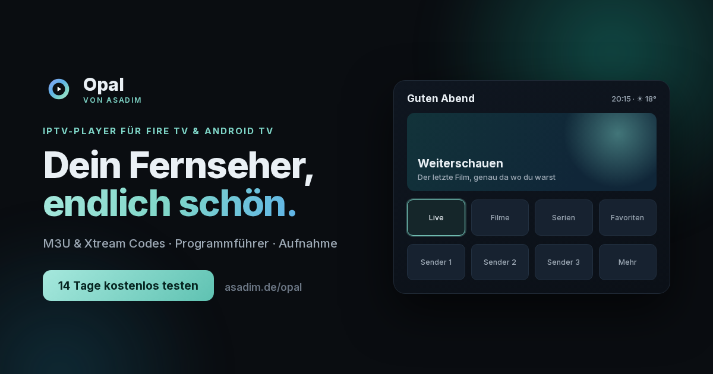

  

<h1 align="center">Opal</h1>

  <b>IPTV-Player für Fire TV, Android TV und Google TV</b> 
  Live-TV · Programmführer (EPG) · Filme &amp; Serien · Aufnahmen

<h3 align="center">📺 Downloader-Code: <code>4796320</code></h3>

  In der App „Downloader“ auf Fire TV / Android TV eingeben – oder <code>asadim.de/app</code> 
  Enter in the “Downloader” app on Fire TV / Android TV – or <code>asadim.de/app</code>

  <a href="https://asadim.de/opal/">Webseite</a> ·
  <a href="https://github.com/majid1992/opal/releases/latest">Download</a> ·
  <a href="https://asadim.de/opal/ratgeber/">Ratgeber</a> ·
  <a href="#english">English</a>

---

## Deutsch

Opal ist ein schneller, ruhiger Player für den Fernseher. Gebaut für die Fernbedienung, nicht für den Touchscreen: jede Taste reagiert sofort, nichts lenkt vom Bild ab.

### Installieren

**Am einfachsten mit der App „Downloader“** (kostenlos im Amazon Appstore und bei Google Play):

1. Downloader öffnen.
2. Den Code **`4796320`** eingeben, oder die Adresse **`asadim.de/app`**.
3. Installieren, Opal öffnen, Playlist per QR-Code vom Handy eintragen.

Ausführliche Anleitung mit Hilfe bei Fehlern: [IPTV-Player auf dem Fire TV Stick installieren](https://asadim.de/opal/ratgeber/fire-tv-stick-iptv-player-installieren/)

Oder die APK direkt unter [Releases](https://github.com/majid1992/opal/releases/latest) herunterladen. Opal aktualisiert sich danach selbst.

### Was Opal kann

- **Live-TV** mit übersichtlichem Programmführer, Senderlogos, Favoriten und eigener Sortierung
- **Zeitversetzt und Archiv**, wenn deine Playlist Catch-up anbietet
- **Filme und Serien** mit Postern, Beschreibung und „Weiterschauen“
- **Untertitel**, online gesucht und sauber eingeblendet
- **Aufnahmen, Mehrfachansicht und Bild-in-Bild**
- **M3U und Xtream Codes**, am Fernseher eingeben oder per QR-Code vom Handy
- **Mein Opal**: Fernbedienung, Sleeptimer und Kinderzeit vom Handy
- **Drei Sprachen**: Deutsch, Englisch, Persisch

### Preise

| | Free | Premium |
|---|---|---|
| Live-TV mit Programmführer, Favoriten, 18+ mit PIN | ✓ | ✓ |
| Filme, Serien, Untertitel | | ✓ |
| Mehrere Playlists, Aufnahmen, Archiv, Mehrfachansicht | | ✓ |

14 Tage alles kostenlos testen, ohne Konto und ohne Karte. Danach bleibt Live-TV gratis. Premium gibt es als Jahresabo, jederzeit zum Laufzeitende kündbar: [aktuelle Preise](https://asadim.de/opal/preise/).

> Opal ist ein reiner Player und liefert keine Sender, Filme oder Serien. Nutze nur Playlists, zu denen du berechtigt bist.

---

## English

Opal is a fast, calm player for your TV. Built for the remote, not for touch: every key responds instantly and nothing gets in the way of the picture.

### Install

**The easiest way is the “Downloader” app** (free in the Amazon Appstore and on Google Play):

1. Open Downloader.
2. Enter the code **`4796320`**, or the address **`asadim.de/app`**.
3. Install, open Opal and add your playlist by scanning the QR code with your phone.

Or download the APK from [Releases](https://github.com/majid1992/opal/releases/latest). Opal keeps itself up to date afterwards.

### Features

- **Live TV** with a clear programme guide (EPG), channel logos, favourites and your own order
- **Time shift and archive** when your playlist offers catch-up
- **Movies and series** with posters, plot and “Continue watching”
- **Subtitles**, found online and shown cleanly
- **Recordings, multi-view and picture-in-picture**
- **M3U and Xtream Codes**, typed on the TV or sent from your phone via QR code
- **My Opal**: remote control, sleep timer and kids' time from your phone
- **Three languages**: German, English, Persian

### Pricing

Try everything free for 14 days, no account and no card needed. Live TV stays free afterwards. Premium is a yearly subscription you can cancel any time: [current prices](https://asadim.de/en/opal/pricing/).

> Opal is a player only and does not provide any channels, movies or series. Use only playlists you are entitled to.

---

  Opal ist eine Entwicklung der Asadim IT-Consulting · <a href="https://asadim.de/opal/">asadim.de/opal</a> · <a href="https://asadim.de/impressum/">Impressum</a> 
  Der Quellcode ist nicht öffentlich. · The source code is not public.

