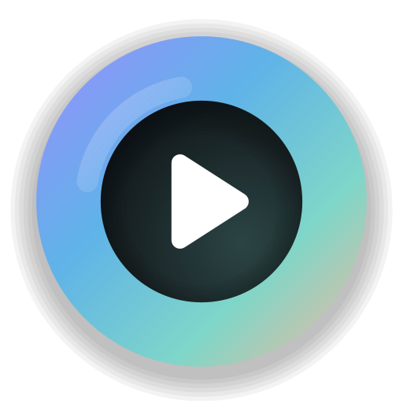

  

<h1 align="center">Opal</h1>

  <b>IPTV-Player für Fire TV und Android TV</b> 
  Live-TV · Programmführer · Filme &amp; Serien · Aufnahmen

  <a href="#deutsch">Deutsch</a> · <a href="#english">English</a> · <a href="#فارسی">فارسی</a>

---

## Deutsch

Opal ist ein schneller, ruhiger Player für den Fernseher. Gebaut für die Fernbedienung, nicht für den Touchscreen: jede Taste reagiert sofort, nichts lenkt vom Bild ab.

**Was Opal kann**
- **Live-TV** mit Senderliste, Programmführer (EPG) und Zeitversatz, wenn der Anbieter Catch-up liefert
- **Filme und Serien** mit Postern, Beschreibung, Besetzung und „Weiterschauen“
- **Intro und Abspann überspringen** bei Serien, nächste Folge automatisch
- **Zwei Untertitel gleichzeitig**, z. B. Persisch unten und Deutsch oben, dazu automatische Übersetzung, wenn eine Sprache fehlt
- **Profile** für die ganze Familie, mit Kinderprofil und PIN
- **Aufnahmen** auf USB-Stick oder Netzlaufwerk (SMB, FTP, WebDAV)
- **Multi-View und Bild-in-Bild**, Sleeptimer, Erinnerungen für Spiele deiner Mannschaft
- **Drei Sprachen:** Deutsch, Englisch, Persisch (von rechts nach links)

**Installation**
1. Auf dem Fire TV die App **Downloader** öffnen.
2. Adresse eingeben: `toranj-it.com/opal/app`
3. Installieren, Opal öffnen, Playlist hinzufügen.

**Preise:** 14 Tage kostenlos testen, danach einmalig freischalten: [asadim.de/opal](https://asadim.de/opal/)

> Opal ist ein reiner Player und liefert keine Sender, Filme oder Serien. Nutze nur Playlists, zu denen du berechtigt bist.

---

## English

Opal is a fast, calm player for your TV. Built for the remote, not for touch: every key responds instantly and nothing gets in the way of the picture.

**Features**
- **Live TV** with channel list, programme guide (EPG) and time shift when your provider offers catch-up
- **Movies and series** with posters, plot, cast and "Continue watching"
- **Skip intro and credits** in series, next episode plays automatically
- **Two subtitles at once**, e.g. Persian at the bottom and English at the top, plus automatic translation when a language is missing
- **Profiles** for the whole family, including a kids profile with PIN
- **Recordings** to USB or network storage (SMB, FTP, WebDAV)
- **Multi-view and picture-in-picture**, sleep timer, reminders for your team's matches
- **Three languages:** German, English, Persian (right-to-left)

**Install**
1. Open the **Downloader** app on your Fire TV.
2. Enter: `toranj-it.com/opal/app`
3. Install, open Opal, add your playlist.

**Pricing:** 14 days free, then a one-time unlock: [asadim.de/opal](https://asadim.de/opal/)

> Opal is a player only and does not provide any channels, movies or series. Use only playlists you are entitled to.

---

## فارسی

اوپال یک پخش‌کننده سریع و آرام برای تلویزیون است. برای کنترل تلویزیون ساخته شده، نه برای صفحه لمسی: هر دکمه فوری جواب می‌دهد و هیچ چیز جلوی تصویر را نمی‌گیرد.

**امکانات**
- **تلویزیون زنده** با فهرست شبکه‌ها، جدول برنامه‌ها و پخش با تاخیر، اگر سرویس‌دهنده آرشیو داشته باشد
- **فیلم و سریال** با پوستر، خلاصه داستان، بازیگران و «ادامه تماشا»
- **رد کردن تیتراژ** در سریال‌ها و پخش خودکار قسمت بعد
- **دو زیرنویس همزمان**، مثلا فارسی پایین و آلمانی بالا، و ترجمه خودکار وقتی زبانی نیست
- **پروفایل** برای همه اعضای خانواده، با پروفایل کودک و رمز
- **ضبط برنامه** روی فلش یا حافظه شبکه (SMB، FTP، WebDAV)
- **چند تصویر همزمان و تصویر در تصویر**، تایمر خواب، یادآوری بازی‌های تیم محبوب شما
- **سه زبان:** فارسی، آلمانی، انگلیسی

**نصب**
۱. روی فایر تی‌وی برنامه **Downloader** را باز کنید.
۲. این آدرس را وارد کنید: `toranj-it.com/opal/app`
۳. نصب کنید، اوپال را باز کنید و پلی‌لیست خود را اضافه کنید.

**قیمت:** ۱۴ روز رایگان، بعد یک بار فعال‌سازی: [asadim.de/opal](https://asadim.de/opal/)

> اوپال فقط یک پخش‌کننده است و هیچ شبکه، فیلم یا سریالی ارائه نمی‌دهد. فقط از پلی‌لیست‌هایی استفاده کنید که حق استفاده از آن‌ها را دارید.

---

© 2026 Majid Asadi · <a href="https://toranj-it.com">Toranj IT</a>

